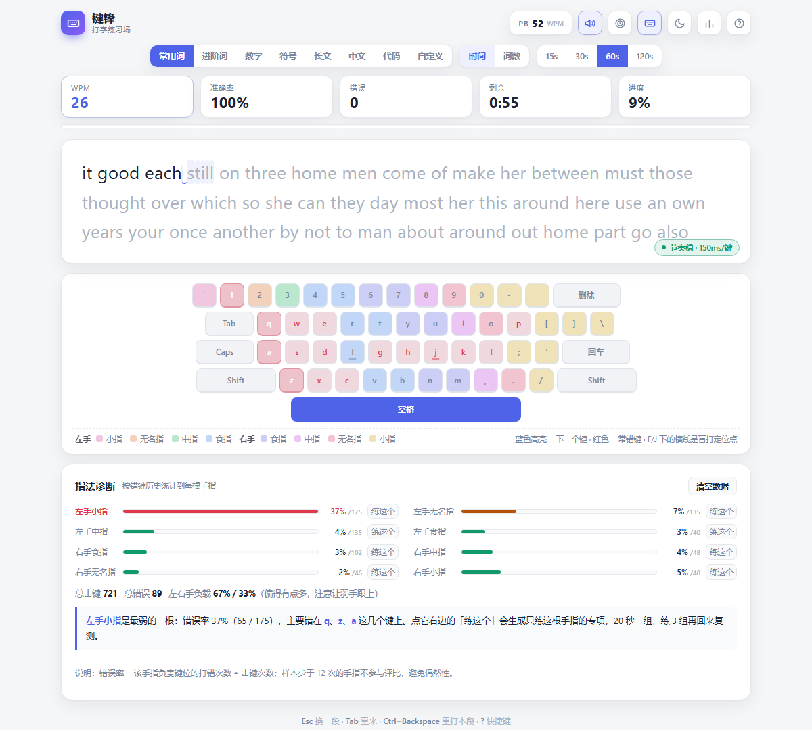

# 键锋 · 打字练习场

浏览器里的打字练习场。**单文件、零依赖、双击就能跑。**



## 它想解决的问题

常见打字网站告诉你「你多快」，但不告诉你「你哪里不对」。
打不快通常是两个具体原因：**某几根手指不听话**，以及**节奏忽快忽慢靠冲刺**。这两件事光看 WPM 是看不出来的。

所以这个站点把反馈拆到手指和节奏两个层面：打完一段会告诉你哪根手指最弱、错在哪几个键，并直接生成只练那根手指的专项；打字过程中实时提示节奏是否稳定。

## 功能

### 练习

- **8 种内容模式**：常用词、进阶词（技术词汇）、数字、符号、长文、中文、代码、自定义
- **2 种测试类型**：时间（15/30/60/120 秒）、词数（10/25/50/100）
- 时间模式下文本**无限续写**，打满不会中断

### 指法矫正

- **指法诊断**：把错键历史按标准指法聚合到 8 根手指，算错误率并找出最弱的一根，结论会点出具体错在哪几个键
- **单指专项**：生成只包含该手指键位的伪词串，七成打目标键、三成回同侧 home row 落位
- **节奏反馈**：实时计算最近击键间隔的变异系数，稳 / 略有起伏 / 忽快忽慢三档提示
- **左右手负载**：击键分布偏差过大时提醒弱手跟上

### 结果与复盘

- 9 项指标：速度、准确率、原始速度、一致性、击键速度、退格次数、用时、正确字符、错误字符
- 速度曲线（实线有效速度 / 虚线原始速度）
- 最易错键、最慢键（平均击键间隔）、打错明细（期望字符 → 实际打的）
- **重练错字**：把这次打错的字符拼成一段专项练习
- 历史记录、个人最佳（PB）、与上次成绩对比

### 细节

- 虚拟键盘按**指法分区**上色，还原真实键盘的行错位，F / J 带盲打定位横线
- 常错键在键盘上标红，下一个待按键高亮
- 3 套主题（浅色 / 深色 / 护眼）、严格模式、按键音
- 快捷键：`Esc` 换一段、`Tab` 重打本段、`Ctrl+Backspace` 重打本段、`?` 帮助

## 技术

原生 JavaScript，**无框架、无构建、无第三方依赖**，全部逻辑在一个 HTML 文件里。

- 输入走隐藏 `textarea` 捕获，支持中文输入法组合（`compositionstart/end`），拼音以虚线下划线实时显示
- 渲染按字符生成 `span`，速度靠维护字符索引而不是整段重绘
- 键盘热力图、指法统计、历史成绩都存 `localStorage`，**不上传任何服务器**
- 三种主题用 CSS 自定义属性切换，无重复样式表

之所以是单文件：这个站点的托管环境对静态子资源有访问限制，单文件既避开这个问题，也让分发变成「下载一个文件、双击打开」。

## 跑起来

```bash
# 方式一：直接双击 index.html

# 方式二：起个本地服务（localStorage 在 file:// 下会被浏览器禁用，想保存成绩就用这个）
python3 -m http.server 8000
# 打开 http://localhost:8000
```

## 说明

- 成绩与错键统计只存在本机浏览器，清缓存或换浏览器会丢
- 主要面向桌面键盘设计；窄屏下虚拟键盘会隐藏，打字区仍可用
- 截图中的指法数据为演示用样例数据
- **时间线**：站点本体 2026.10 用 AI 辅助从零构建并上线；本仓库 2026.11 才创建，因为那时才把代码整理成可公开的形式（补 README、截图、LICENSE）。提交记录集中在 2026.11 是这个原因，不是「一个晚上写完的」。
